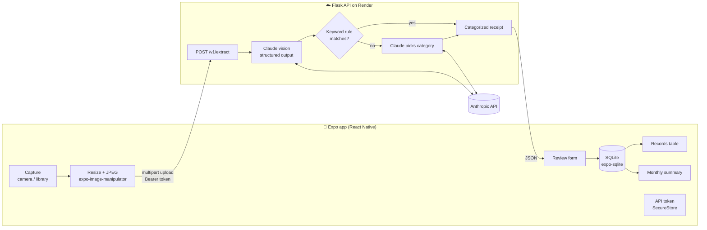

# 🧾 Receipt & Expense Organizer

Snap a photo of a receipt on your phone and get back a clean, categorized expense.
A small Flask API uses **Claude's vision** to read the receipt, then categorizes it
with editable keyword rules first and Claude as the fallback.
The **Expo / React Native** app lets you review the result, keeps your records in a
sortable table, and shows a monthly spending summary.

Your expense data stays on your phone (SQLite). The server stores nothing, and the
Anthropic API key never leaves the server.

## Features

- **Extraction**: vendor, date, total, currency and line items from photos (JPG/PNG/GIF/WEBP) or PDFs, using Claude structured outputs so the JSON always matches the schema.
- **Categorization**: case-insensitive keyword rules from [`categories.json`](backend/categories.json) (longest match wins, so `uber eats` beats `uber`). Claude only steps in when no rule matches.
- **Review before saving**: missing fields are highlighted, and low-confidence extractions are flagged instead of guessed.
- **Records**: a spreadsheet-style table with sortable columns, plus totals per currency.
- **Monthly summary**: each currency's total, with categories ranked by spend.
- **Simple auth**: one shared bearer token, kept in the phone's secure keychain.

## Architecture



**API** (every endpoint except health needs `Authorization: Bearer <API_TOKEN>`):

| Method | Path | Purpose |
|---|---|---|
| `GET` | `/v1/health` | Liveness check (no auth) |
| `GET` | `/v1/categories` | Valid categories for the app's picker |
| `POST` | `/v1/extract` | Multipart field `receipt` → extracted, categorized receipt |

Errors always look like `{"error": {"code": "...", "message": "..."}}`.

```
Receipt-Organizer/
├── backend/              # Flask API (Python 3.13)
│   ├── app.py            # create_app(): routes, auth, error handling
│   ├── agent.py          # Claude extraction + categorization
│   ├── categorizer.py    # pure keyword-rule engine
│   ├── categories.json   # ← edit to add categories / vendor rules
│   └── tests/            # pytest suite
├── mobile/               # Expo SDK 57 app (TypeScript, Expo Router)
│   ├── src/app/          # screens: (tabs)/ Capture, Records, Summary, Settings; review modal
│   ├── src/api/          # fetch client + Zod schemas
│   ├── src/db/           # SQLite access
│   ├── src/lib/          # pure logic (review, sorting, summary, money)
│   └── eas.json          # Android APK build profile
├── render.yaml           # Render blueprint for the API
└── .github/workflows/    # CI: backend + mobile checks
```

## Setup

### Backend

Requires Python 3.13 and an [Anthropic API key](https://console.anthropic.com/settings/keys).

```bash
python3.13 -m venv .venv
.venv/bin/pip install -r backend/requirements-dev.txt

cp backend/.env.example backend/.env
# edit backend/.env: set ANTHROPIC_API_KEY and API_TOKEN
# make a token with: python3 -c "import secrets; print(secrets.token_urlsafe(32))"

cd backend
../.venv/bin/python app.py                     # → http://127.0.0.1:5000
curl localhost:5000/v1/health
```

To reach the local server from your phone (same Wi-Fi), listen on all interfaces and
use your computer's LAN IP in the app's Settings, e.g. `http://192.168.1.20:5001`:

```bash
../.venv/bin/flask --app app run --host 0.0.0.0 --port 5001
```

> macOS often uses port 5000 for AirPlay Receiver, so use 5001 if 5000 is taken.

**No API credits?** Set `MOCK_EXTRACTION=1` and every upload returns a canned sample
receipt, so you can try the whole flow for free.

### Mobile

Requires Node 22 and the [Expo Go](https://expo.dev/go) app on your phone.
Expo Go must be an SDK 57 build.

```bash
cd mobile
npm install
npx expo start -c        # scan the QR code with your camera (iOS) or Expo Go (Android)
```

In the app, open **Settings**, enter the server URL and your `API_TOKEN`, then tap
**Save & test connection**. The URL defaults to the hosted API.

Add packages with `npx expo install <pkg>` so the versions match SDK 57.

## Environment variables

Backend, set in `backend/.env` locally or in the Render dashboard:

| Variable | Required | Default | Purpose |
|---|---|---|---|
| `ANTHROPIC_API_KEY` | ✅ | — | Claude access for extraction and categorization |
| `API_TOKEN` | ✅ | — | Shared secret the app sends as `Bearer <token>` |
| `CLAUDE_MODEL` | — | `claude-opus-4-8` | Override the model |
| `MOCK_EXTRACTION` | — | off | `1` returns a sample receipt instead of calling Claude |
| `PORT` | — | `5000` | Dev server port |

The mobile app needs no env vars. The server URL and token are entered in
Settings and stored on the device.

## Testing

```bash
# Backend: extraction, categorization and API contract (Claude is mocked)
cd backend && ../.venv/bin/python -m pytest -q

# Mobile: typecheck, lint, unit + component tests, dependency check
cd mobile && npx tsc --noEmit && npx expo lint && npx jest && npx expo-doctor
```

[CI](.github/workflows/ci.yml) runs both suites on every push to `main` and on pull requests.

Test a single piece by hand:

```bash
cd backend
../.venv/bin/python categorizer.py "Trader Joe's #451"   # → Groceries (rule match)
../.venv/bin/python agent.py path/to/receipt.jpg         # extract + categorize → JSON
```

## Deploy

### API on Render

1. In Render: **New → Blueprint**, then pick this repo. [`render.yaml`](render.yaml) sets up a free web service running gunicorn with a 120 s timeout.
2. Enter `ANTHROPIC_API_KEY` and `API_TOKEN` in the dashboard. They are never committed.
3. Every push to `main` redeploys. Render checks `/v1/health` to confirm the server is up.

The free tier sleeps when idle, so the first request after a while can take about
a minute. The app's timeouts allow for this.

### Android APK with EAS Build

```bash
cd mobile
npx eas-cli@latest login
npx eas-cli@latest build -p android --profile preview
```

The `preview` profile in [`eas.json`](mobile/eas.json) builds an installable `.apk`
for internal distribution. EAS links the project and creates a signing key on the
first run. Open the build link on an Android phone to install it. The APK should
point at the HTTPS server URL: release builds block plain `http://`.

iOS runs through Expo Go. A TestFlight build would need an Apple Developer account.

## Tech stack

**Backend:** Python 3.13 · Flask · gunicorn · [Anthropic SDK](https://docs.anthropic.com) (vision + structured outputs) · Pydantic · pytest · Render

**Mobile:** Expo SDK 57 · React Native · TypeScript · Expo Router (native tabs) · expo-sqlite · TanStack Query · Zod · Jest + React Native Testing Library · EAS Build
